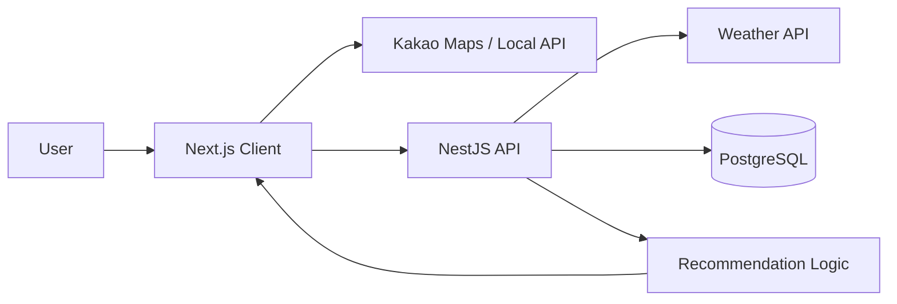

# Weather Eat 🌦️🍽️

> **현재 날씨와 위치를 기반으로 지금 가기 좋은 식당을 추천해주는 앱**

`Next.js` · `NestJS` · `TypeScript` · `PostgreSQL` · `TypeORM` · `Docker` · `Kakao API`

---

## Overview

**Weather Eat**은 사용자의 현재 위치와 날씨를 분석해 주변 식당을 추천해주는 서비스입니다.

단순히 가까운 식당을 보여주는 것이 아니라,

> **“오늘 같은 날씨에는 뭘 먹으면 좋을까?”**

라는 질문에서 시작했습니다.

비가 오는 날, 더운 날, 추운 날처럼 날씨 상황에 따라 어울리는 음식과 식당을 추천하고, 지도에서 위치를 확인한 뒤 원하는 식당을 선택할 수 있도록 구현했습니다.

---

## Main Features

### 🌦️ 날씨 기반 추천

현재 날씨 정보를 활용해 식당 추천 결과에 반영합니다.

예를 들어,

- 비 오는 날
- 더운 날
- 추운 날
- 맑은 날

등의 조건에 따라 음식과 식당의 적합도를 계산합니다.

---

### 📍 위치 기반 식당 탐색

사용자의 현재 위치 또는 검색한 지역을 기준으로 주변 식당을 탐색합니다.

- Kakao Maps API
- Kakao Local API
- 지도 마커 표시
- 지도 이동 후 재검색
- 검색 반경 조절

---

### 🍽️ 식당 추천 점수

Weather Eat은 여러 조건을 조합해 식당의 추천 점수를 계산합니다.

```text
Weather
   +
Time
   +
Distance
   ↓
Recommendation Score
   ↓
Restaurant Ranking
```

주요 요소는 다음과 같습니다.

- 현재 날씨
- 시간대
- 사용자와 식당 사이의 거리

계산된 결과를 바탕으로 식당을 정렬하고 추천 이유를 함께 제공합니다.

---

### 🔎 카테고리 필터

원하는 음식 종류를 기준으로 검색 결과를 필터링할 수 있습니다.

- 한식
- 중식
- 일식
- 양식
- 카페

---

### 👤 사용자 기능

- 회원가입
- 로그인
- JWT 기반 인증
- 프로필 관리

---

### 📅 식당 예약

추천받은 식당을 확인한 뒤 예약할 수 있습니다.

- 예약 생성
- 내 예약 조회

---

## Architecture



Frontend와 Backend를 분리하고, 서버에서 날씨 데이터와 식당 데이터를 조합해 추천 결과를 생성하도록 구성했습니다.

---

## Tech Stack

| Area | Technology |
|---|---|
| Frontend | Next.js 16, React 19 |
| Language | TypeScript |
| Styling | Tailwind CSS 4 |
| Backend | NestJS 11 |
| ORM | TypeORM |
| Database | PostgreSQL 16 |
| Authentication | JWT, bcrypt |
| Maps | Kakao Maps / Local API |
| Weather Data | 공공데이터 API |
| Infrastructure | Docker, Docker Compose |

---

## Project Structure

```text
weather-eat/
├── client/
│   ├── app/
│   ├── components/
│   ├── hooks/
│   └── types/
│
├── server/
│   └── src/
│       ├── auth/
│       ├── restaurants/
│       ├── reservations/
│       ├── users/
│       └── weather/
│
├── docs/
└── README.md
```

---

## What I Built

이 프로젝트에서는 날씨 데이터를 단순히 표시하는 데 그치지 않고, 실제 서비스의 추천 기준으로 활용하는 데 집중했습니다.

- 날씨 기반 Restaurant Recommendation Logic
- 위치 기반 식당 탐색
- Kakao Maps / Local API 연동
- 공공 날씨 데이터 연동
- NestJS 기반 REST API
- JWT Authentication
- PostgreSQL / TypeORM 기반 데이터 관리
- 식당 예약 기능
- Docker 기반 개발 환경 구성

---

## What I Learned

Weather Eat을 개발하며 여러 외부 데이터를 하나의 서비스 기능으로 연결하는 경험을 했습니다.

특히,

- 외부 API 연동
- 지도 기반 UI
- 추천 Logic 설계
- Frontend / Backend 분리
- Authentication
- Database 설계
- Docker 기반 개발 환경

을 직접 구성했습니다.

가장 중요하게는 **날씨라는 Context Data를 실제 사용자 추천 결과로 연결하는 방법**을 고민해볼 수 있었습니다.

---

## Closing

**Weather Eat은 날씨에 따라 달라지는 사용자의 음식 선택을 더 쉽게 만드는 것을 목표로 합니다.**

> Weather → Restaurant Recommendation → Better Choice
