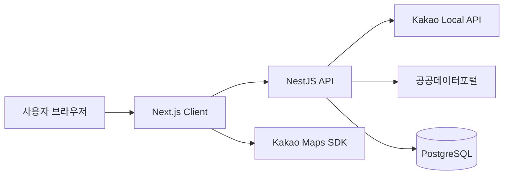
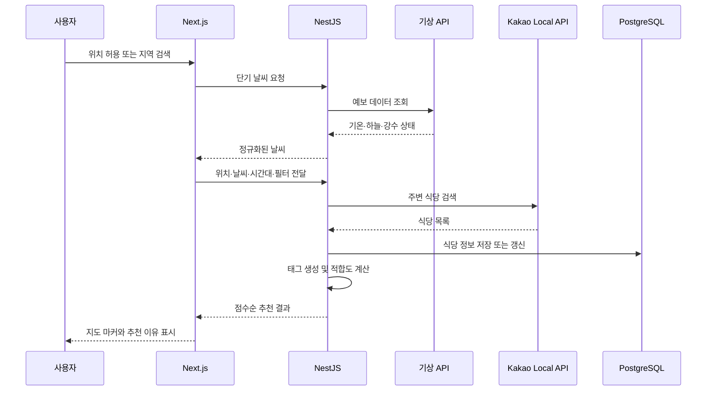

# Architecture

## 시스템 개요

Weather Eat은 Next.js 클라이언트와 NestJS API 서버를 분리한 구조입니다. 클라이언트는 위치·검색·지도 인터랙션을 담당하고, 서버는 외부 API 연동, 추천 점수 계산, 인증과 예약 데이터를 관리합니다.

## 주요 요청 흐름

### 식당 추천

### 인증 및 예약

1. 사용자가 이메일과 비밀번호로 가입하거나 로그인합니다.
2. 서버는 비밀번호를 bcrypt로 처리하고 JWT를 발급합니다.
3. 클라이언트는 보호된 예약·프로필 요청에 JWT를 전달합니다.
4. 서버의 JWT Guard가 요청을 검증한 뒤 사용자별 데이터를 조회합니다.

## 클라이언트 구조

- `app/`: App Router 페이지와 날씨 API 프록시
- `components/home/`: 검색, 지도, 추천 목록, 상세 패널, 예약 폼
- `hooks/`: 인증, 지도, 추천, 예약, 날씨 상태 로직
- `types/`: 사용자와 식당 응답 타입

날씨 프록시는 브라우저가 공공데이터 API 키를 직접 다루지 않도록 NestJS 서버를 경유합니다. 배포 환경의 서버 주소는 `BACKEND_API_URL`로 주입합니다.

## 서버 구조

- `auth/`: 회원가입, 로그인, JWT 인증
- `users/`: 프로필, 닉네임, 위치 관리
- `restaurants/`: 식당 검색, 추천 점수, 상세 정보, 클릭 기록
- `reservations/`: 예약 생성과 사용자별 조회
- `weather/`: 기상청 단기·중기예보 및 대기 데이터 정규화
- `common/kakao/`: Kakao 요청, 응답 파싱, 카테고리·태그 변환

## 데이터 저장

PostgreSQL에는 사용자, 식당, 예약, 식당 클릭 기록을 저장합니다. Kakao에서 받은 식당은 고유 장소 ID를 기준으로 중복을 제거하며, 상세 정보는 최초 요청 시 저장해 반복 요청을 줄입니다.

## 환경별 경계

- 공개 가능한 값: 로컬 포트, API 서버 URL
- 반드시 환경변수로 관리할 값: JWT Secret, Kakao REST API 키, 공공데이터 API 키
- 브라우저에 전달되는 값: Kakao JavaScript 키. Kakao Developers에서 허용 도메인을 제한해야 합니다.

